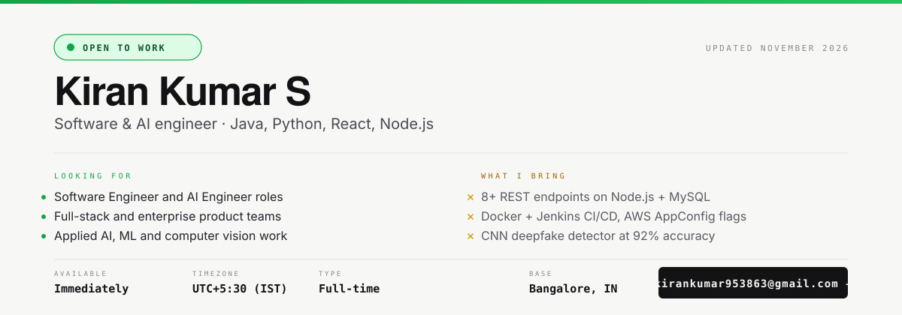

 

 

<table align="center">
<tr>
<td align="center" width="25%"><b>🎯 Role</b> Software / AI Engineer</td>
<td align="center" width="25%"><b>📍 Location</b> Bangalore, India</td>
<td align="center" width="25%"><b>🟢 Status</b> Open to work</td>
<td align="center" width="25%"><b>🧰 Stack</b> Java · Python · React · Node.js</td>
</tr>
</table>

 

<i>Software engineer building AI-powered products: LLM automation pipelines, OCR, and full-stack web apps.</i>

## 🚀 Top 3 Projects

<table>
<tr>
<td width="100%" valign="top">

### 🤖 1 · AI News → LinkedIn
**LLM publishing pipeline with human approval.**

AI news goes in, an LLM drafts the post, **a human approves it**, and only then does it publish to LinkedIn. The approval step keeps automation fast without losing editorial control.

Repository private for now · details on request

</td>
</tr>
<tr>
<td width="100%" valign="top">

### ✍️ 2 · AI Handwritten Text Extractor
**Handwritten notes → editable digital text.**

OCR pipeline with image preprocessing (thresholding, denoising, contrast enhancement) feeding Tesseract to turn handwritten pages into clean text.

[**View repository →**](https://github.com/kiran-kumars953/HandwriteAiApplication)

</td>
</tr>
<tr>
<td width="100%" valign="top">

### 🌐 3 · Personal Portfolio
**Live at [me.nmstudios.ai](https://me.nmstudios.ai).**

Responsive single-page portfolio built with React and Vite, with Framer Motion and AOS animations, deployed on Cloudflare.

[**Live site →**](https://me.nmstudios.ai) · [**Source →**](https://github.com/kiran-kumars953/personal-portfolio)

</td>
</tr>
</table>

<a href="https://github.com/kiran-kumars953?tab=repositories">Browse all repositories →</a>

---

## 🛠️ Stack

---

## 💼 Experience

<table>
<tr>
<td width="24%" valign="top"><b>Sep 2025 – Jun 2026</b> Bangalore</td>
<td valign="top">

**Software Engineer – AI** · Aseuro Technologies

AWS AppConfig feature flags · Docker + Jenkins CI/CD · Salesforce insurance apps · Agile delivery

</td>
</tr>
<tr>
<td valign="top"><b>Oct – Dec 2024</b></td>
<td valign="top">

**Application Developer Intern** · Rooman Technologies

Built **8+ REST endpoints** on Node.js and MySQL, tested with Postman.

</td>
</tr>
</table>

<b>More: earlier internships, leadership, certifications</b>

 

| When | Role | Highlight |
|---|---|---|
| Feb – Mar 2024 | **Software Engineering Virtual Intern**, J.P. Morgan Chase & Co. | Virtual internship |
| May – Jun 2023 | **ML Intern**, NASSCOM Foundation | 2 ML projects at **~90% accuracy**, co-led a 4-member team, top 3 in showcase |
| Jan – Dec 2024 | **Chair**, IEEE Computer Society Student Branch, Vemana IT | 6 workshops, 2 hackathons, **+40% membership** |
| Oct 2024 – Feb 2025 | **College Ambassador**, Rooman Technologies | Onboarded **50+ students** |

**Certifications:** Generative AI & Tableau (Unifirst Robotics) · Foundation of AI (Infosys SpringBoard) · Machine Learning Foundation (NASSCOM) · Application Developer, Web & Mobile (Rooman) · SWE Virtual Internship (J.P. Morgan)

---

## 🤝 Let's connect

 

Bangalore, Karnataka, India · <a href="https://me.nmstudios.ai">me.nmstudios.ai</a>

