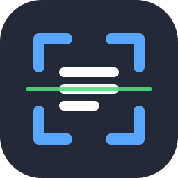

 

 

<table align="center">
<tr>
<td align="center" width="25%"><b>🎯 Role</b> Software / AI Engineer</td>
<td align="center" width="25%"><b>📍 Location</b> Bangalore, India</td>
<td align="center" width="25%"><b>🟢 Status</b> Open to work</td>
<td align="center" width="25%"><b>🧰 Stack</b> Python · React · Node.js · LLM APIs</td>
</tr>
</table>

 

<i>Software engineer building AI-powered products: LLM automation pipelines, OCR, and full-stack web apps.</i>

## 🚀 Featured Projects

<table>
<tr>
<td width="100%" valign="top">

### 🤖 1 · AI News → LinkedIn
**LLM publishing pipeline with human approval.**

Reads 12 AI engineering blogs, picks a fresh story, drafts the post with Gemini, scores it on a 10-check quality rubric and renders a card or carousel. **A human approves it** through HMAC-signed, expiring links before it publishes via the LinkedIn API. Runs daily on GitHub Actions + Apps Script, no server.

<table><tr><td align="center" width="72"> Python</td><td align="center" width="72"> Gemini</td><td align="center" width="72"> Apps Script</td><td align="center" width="72"> LinkedIn API</td><td align="center" width="72"> GitHub Actions</td><td align="center" width="72"> Human in the loop</td></tr></table>

[**View repository →**](https://github.com/kiran-kumars953/linkedin-ai-autopost-showcase)

</td>
</tr>
<tr>
<td width="100%" valign="top">

### 🌐 2 · Personal Portfolio
**Live at [me.nmstudios.ai](https://me.nmstudios.ai).**

Responsive single-page portfolio (React 19, Vite, Tailwind) on Cloudflare Workers, with a tested serverless contact API.

<table><tr><td align="center" width="72"> React</td><td align="center" width="72"> Vite</td><td align="center" width="72"> Tailwind</td><td align="center" width="72"> Cloudflare Workers</td></tr></table>

[**Live site →**](https://me.nmstudios.ai) · [**Source →**](https://github.com/kiran-kumars953/personal-portfolio-showcase)

</td>
</tr>
<tr>
<td width="100%" valign="top">

### 🛡️ 3 · CLAIMops: AI claims processing
**OCR + LLM extraction → human review → 10-rule policy engine → carrier portal.**

Reads a claim form and hospital bill, pre-fills the claim with a confidence score, flags mismatches across documents, and routes only the doubtful cases to a person. Three services (Spring Boot API, React/TypeScript portal, FastAPI extraction) run with one `docker compose up`.

<table><tr><td align="center" width="72"> React</td><td align="center" width="72"> TypeScript</td><td align="center" width="72"> Spring Boot</td><td align="center" width="72"> FastAPI</td><td align="center" width="72"> Tesseract</td><td align="center" width="72"> Hugging Face</td><td align="center" width="72"> Docker</td></tr></table>

[**View repository →**](https://github.com/kiran-kumars953/claimops-showcase)

</td>
</tr>
<tr>
<td width="100%" valign="top">

### ✍️ 4 · AI Handwritten Form Extractor
**Handwritten form image → structured JSON / CSV.**

Tesseract OCR reads the page, then GPT-4o-mini turns the raw text into named fields with confidence scores against a strict schema. Rate-limit retries, a safe fallback when the model returns bad JSON, run tracking, JSON/CSV export and OpenTelemetry tracing. Spring Boot API with a React UI.

<table><tr><td align="center" width="72"> Java</td><td align="center" width="72"> Spring Boot</td><td align="center" width="72"> React</td><td align="center" width="72"> Tesseract</td><td align="center" width="72"> OpenAI</td><td align="center" width="72"> OpenTelemetry</td></tr></table>

[**View repository →**](https://github.com/kiran-kumars953/ai-handwritten-form-extractor)
</td>
</tr>
</table>

<a href="https://github.com/kiran-kumars953?tab=repositories">Browse all repositories →</a>

---

## 🧭 How I work

Every showcase repo ships with **CI on each push**, **automated tests**, a README with architecture diagrams and setup steps, and contributing / security docs. Secrets stay in environment variables, never in code.

---

## 🛠️ Tech stack

<table align="center">
<tr><td><b>Languages</b></td><td><table><tr><td align="center" width="80"> Python</td><td align="center" width="80"> JavaScript</td><td align="center" width="80"> TypeScript</td><td align="center" width="80"> Java</td></tr></table></td></tr>
<tr><td><b>Frontend</b></td><td><table><tr><td align="center" width="80"> React</td><td align="center" width="80"> Vite</td><td align="center" width="80"> Tailwind</td></tr></table></td></tr>
<tr><td><b>Backend</b></td><td><table><tr><td align="center" width="80"> Node.js</td><td align="center" width="80"> Express</td><td align="center" width="80"> FastAPI</td><td align="center" width="80"> Spring Boot</td></tr></table></td></tr>
<tr><td><b>AI / ML</b></td><td><table><tr><td align="center" width="80"> Gemini</td><td align="center" width="80"> OpenAI</td><td align="center" width="80"> Tesseract</td><td align="center" width="80"> PyTorch</td><td align="center" width="80"> OpenCV</td><td align="center" width="80"> scikit-learn</td></tr></table></td></tr>
<tr><td><b>Data / Notebooks</b></td><td><table><tr><td align="center" width="80"> Pandas</td><td align="center" width="80"> NumPy</td><td align="center" width="80"> Jupyter</td><td align="center" width="80"> Streamlit</td></tr></table></td></tr>
<tr><td><b>Databases</b></td><td><table><tr><td align="center" width="80"> MySQL</td><td align="center" width="80"> PostgreSQL</td><td align="center" width="80"> MongoDB</td></tr></table></td></tr>
<tr><td><b>DevOps / Cloud</b></td><td><table><tr><td align="center" width="80"> Docker</td><td align="center" width="80"> GitHub Actions</td><td align="center" width="80"> Jenkins</td><td align="center" width="80"> Cloudflare</td><td align="center" width="80"> AWS</td><td align="center" width="80"> OpenTelemetry</td></tr></table></td></tr>
<tr><td><b>Tools</b></td><td><table><tr><td align="center" width="80"> Git</td><td align="center" width="80"> Postman</td></tr></table></td></tr>
</table>

---

## 💼 Experience

<table>
<tr>
<td width="24%" valign="top"><b>Sep 2025 – Jun 2026</b> Bangalore</td>
<td valign="top">

**Software Engineer – AI** · Aseuro Technologies

AWS AppConfig feature flags · Docker + Jenkins CI/CD · Salesforce insurance apps · Agile delivery

</td>
</tr>
<tr>
<td valign="top"><b>Oct – Dec 2024</b></td>
<td valign="top">

**Application Developer Intern** · Rooman Technologies

Built **8+ REST endpoints** on Node.js and MySQL, tested with Postman.

</td>
</tr>
</table>

<b>More: earlier internships, leadership, certifications</b>

 

| When | Role | Highlight |
|---|---|---|
| Feb – Mar 2024 | **Software Engineering Virtual Intern**, J.P. Morgan Chase & Co. | Virtual internship |
| May – Jun 2023 | **ML Intern**, NASSCOM Foundation | 2 ML projects at **~90% accuracy**, co-led a 4-member team, top 3 in showcase |
| Jan – Dec 2024 | **Chair**, IEEE Computer Society Student Branch, Vemana IT | 6 workshops, 2 hackathons, **+40% membership** |
| Oct 2024 – Feb 2025 | **College Ambassador**, Rooman Technologies | Onboarded **50+ students** |

**Certifications:** Generative AI & Tableau (Unifirst Robotics) · Foundation of AI (Infosys SpringBoard) · Machine Learning Foundation (NASSCOM) · Application Developer, Web & Mobile (Rooman) · SWE Virtual Internship (J.P. Morgan)

---

## 🤝 Let's connect

 

Bangalore, Karnataka, India · <a href="https://me.nmstudios.ai">me.nmstudios.ai</a>

