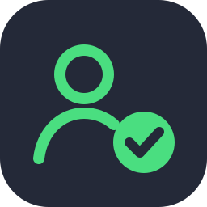

 

<i>Software engineer building AI-powered products: LLM automation pipelines, OCR, and full-stack web apps.</i>

## 🚀 Featured Projects

<table>
<tr><th align="left">Project</th><th align="left">What it does</th><th align="left">Stack</th><th></th></tr>
<tr><td>🤖 <b>AI News → LinkedIn</b></td><td>LLM drafts daily posts from 12 AI blogs; a human approves via signed links before it publishes.</td><td>     </td><td><a href="https://github.com/kiran-kumars953/linkedin-ai-autopost-showcase">Repo</a></td></tr>
<tr><td>🌐 <b>Personal Portfolio</b></td><td>Single-page portfolio on Cloudflare Workers with a tested serverless contact API.</td><td>   </td><td><a href="https://me.nmstudios.ai">Live</a> · <a href="https://github.com/kiran-kumars953/personal-portfolio-showcase">Repo</a></td></tr>
<tr><td>🛡️ <b>CLAIMops</b></td><td>OCR + LLM claim extraction → human review → 10-rule policy engine → carrier portal.</td><td>     </td><td><a href="https://github.com/kiran-kumars953/claimops-showcase">Repo</a></td></tr>
<tr><td>✍️ <b>Handwritten Form Extractor</b></td><td>Handwritten form image → structured JSON/CSV with Tesseract OCR + GPT-4o-mini.</td><td>    </td><td><a href="https://github.com/kiran-kumars953/ai-handwritten-form-extractor">Repo</a></td></tr>
</table>

Every showcase repo ships with CI on each push, automated tests, architecture docs, and secrets kept out of code.

---

## 🛠️ Tech stack

<table align="center">
<tr><td><b>Languages</b></td><td><table><tr><td align="center" width="64"> Python</td><td align="center" width="64"> JavaScript</td><td align="center" width="64"> TypeScript</td><td align="center" width="64"> Java</td></tr></table></td></tr>
<tr><td><b>Web</b></td><td><table><tr><td align="center" width="64"> React</td><td align="center" width="64"> Vite</td><td align="center" width="64"> Tailwind</td><td align="center" width="64"> Node.js</td><td align="center" width="64"> Express</td><td align="center" width="64"> FastAPI</td><td align="center" width="64"> Spring Boot</td></tr></table></td></tr>
<tr><td><b>AI / Data</b></td><td><table><tr><td align="center" width="64"> Gemini</td><td align="center" width="64"> OpenAI</td><td align="center" width="64"> Tesseract</td><td align="center" width="64"> PyTorch</td><td align="center" width="64"> OpenCV</td><td align="center" width="64"> scikit-learn</td><td align="center" width="64"> Pandas</td></tr></table></td></tr>
<tr><td><b>Databases</b></td><td><table><tr><td align="center" width="64"> MySQL</td><td align="center" width="64"> PostgreSQL</td><td align="center" width="64"> MongoDB</td></tr></table></td></tr>
<tr><td><b>DevOps / Tools</b></td><td><table><tr><td align="center" width="64"> Docker</td><td align="center" width="64"> GitHub Actions</td><td align="center" width="64"> Jenkins</td><td align="center" width="64"> Cloudflare</td><td align="center" width="64"> AWS</td><td align="center" width="64"> Git</td><td align="center" width="64"> Postman</td></tr></table></td></tr>
</table>

---

## 💼 Experience

<table>
<tr>
<td width="24%" valign="top"><b>Sep 2025 – Jun 2026</b> Bangalore</td>
<td valign="top">

**Software Engineer – AI** · Aseuro Technologies

AWS AppConfig feature flags · Docker + Jenkins CI/CD · Salesforce insurance apps · Agile delivery

</td>
</tr>
<tr>
<td valign="top"><b>Oct – Dec 2024</b></td>
<td valign="top">

**Application Developer Intern** · Rooman Technologies

Built **8+ REST endpoints** on Node.js and MySQL, tested with Postman.

</td>
</tr>
</table>

<b>More: earlier internships, leadership, certifications</b>

 

| When | Role | Highlight |
|---|---|---|
| Feb – Mar 2024 | **Software Engineering Virtual Intern**, J.P. Morgan Chase & Co. | Virtual internship |
| May – Jun 2023 | **ML Intern**, NASSCOM Foundation | 2 ML projects at **~90% accuracy**, co-led a 4-member team, top 3 in showcase |
| Jan – Dec 2024 | **Chair**, IEEE Computer Society Student Branch, Vemana IT | 6 workshops, 2 hackathons, **+40% membership** |
| Oct 2024 – Feb 2025 | **College Ambassador**, Rooman Technologies | Onboarded **50+ students** |

**Certifications:** Generative AI & Tableau (Unifirst Robotics) · Foundation of AI (Infosys SpringBoard) · Machine Learning Foundation (NASSCOM) · Application Developer, Web & Mobile (Rooman) · SWE Virtual Internship (J.P. Morgan)

---

## 🤝 Let's connect

 

Bangalore, Karnataka, India · <a href="https://me.nmstudios.ai">me.nmstudios.ai</a>

